# Architecture: TiRex-DHS with hard selection (aggressive gather)

This document describes how **`tirex-aggressive-gather`** is built and how a forecast window actually runs. The method is **TiRex-DHS** (Dynamic Horizon-aware Sparse covariate selection). Training uses **soft gates**. Inference uses **hard gather**: covariates that fail a threshold are removed before TiRex-2’s cross-series attention, so the remaining 12 blocks never compute them.

The frozen backbone is **NX-AI/TiRex-2**. Only the selector (~67k parameters) is trained.

---

## 1. Purpose of this architecture

The gather selector is the compute-saving form of TiRex-DHS.

| Goal | How this architecture does it |
|------|-------------------------------|
| Use only required covariates | Score every covariate for the current window and each horizon; keep it only if \(g_{ih} > \tau\) |
| Cut time and FLOPs | Dropped series are **gathered out** before the 12-block stack |
| Avoid noise from unused series | A dropped covariate never appears in variate attention |
| Keep TiRex-2 intact | The pretrained checkpoint stays frozen; the selector is a thin learned head |

The three horizons (7, 30, 60 days) share one 60-day forecast. Scores at 7 and 30 days use the first 7 and 30 steps of that forecast.

---

## 2. System overview

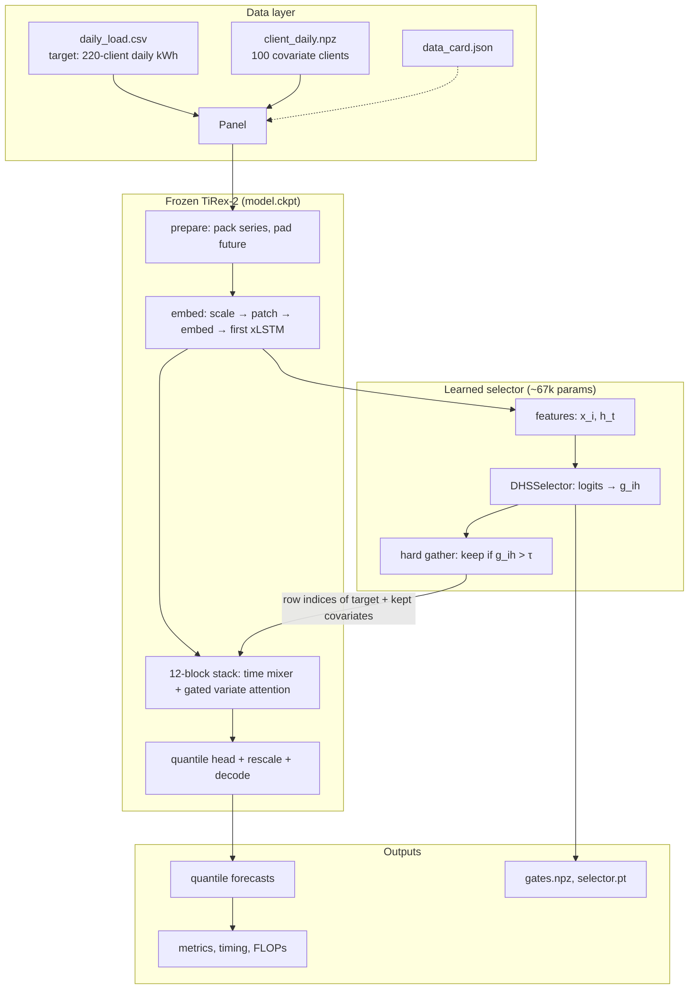

**Read the diagram left to right.** The panel supplies one 192-day window. TiRex-2’s first stages run on **all 101 series** (target + 100 covariates). Those embeddings feed the selector. The selector returns a keep-set. The 12-block stack then runs **only** the target plus the kept covariates. The quantile head produces the forecast.

---

## 3. Folder and component map

```
tirex-aggressive-gather/
  data/                 built panel (same as tirex-base)
  model/                TiRex-2 checkpoint (model.ckpt, model-config.yaml)
  src/tirex_gather/
    config.py           all run settings in one dataclass
    data.py             Panel, chronological origins
    prepare_data.py     optional rebuild from LD2011_2014.txt
    runtime.py          load checkpoint, threads, timing, FLOPs, memory
    backbone.py         staged TiRex-2 + gated variate attention
    selector.py         DHSSelector and context-stability weight
    forecast.py         DHSModel: window / logits / soft / hard
    training.py         selector loss and Adam loop
    pipeline.py         train → tune τ → timed test → reports
    metrics.py          MAE, RMSE, CRPS, MAPE, coverage
    evaluation.py       scoring and output tables
    reporting.py        CSVs, JSON, gate charts
    covariate_probe.py  oracle vs real-client check (plain TiRex-2)
  tests/                data splits, metrics, selector, backbone equivalence
  outputs/              last run
```

| Component | File | Role |
|-----------|------|------|
| Settings | `config.py` | Horizons, splits, λ grid, τ grid, subset size, device |
| Panel | `data.py` | Load series; emit train / val / test origins |
| Frozen backbone | `runtime.py` + `backbone.py` | Load TiRex-2; split the forward pass into stages |
| Selector | `selector.py` | Score each covariate × horizon |
| Forecast wrapper | `forecast.py` | Soft path (train) and hard gather (infer) |
| Trainer | `training.py` | Frozen backbone + Adam on selector |
| Orchestrator | `pipeline.py` | Tune on validation, time the test set, write reports |

---

## 4. Data and windowing

### 4.1 Series layout

Inside one window the model sees **101 univariate series**:

```
row 0        target        sum of 220 clients, daily kWh
rows 1..100  covariates    100 other clients (seed 2012), not in the target sum
```

Context length is **192 days**. The origin is the first day being forecast. The future that is scored is up to **60 days**.

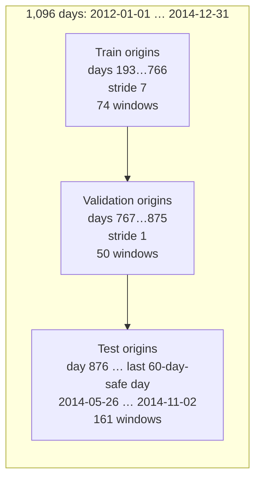

Training origins start one day after the first full context so the stability loss has a previous day (\(h_{t-1}\)).

A window is valid only if:

- the 192-day context lies inside the panel, and
- `origin + 60` does not run past the end of the current split.

### 4.2 What one window contains

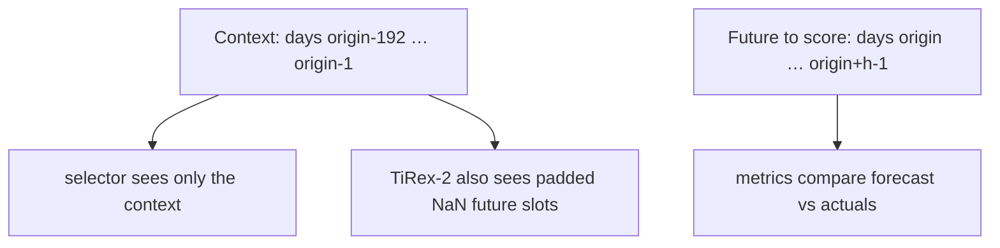

Covariates are **past-only**. There are no future covariates. That is why TiRex-2’s same-time-patch attention has little to work with: the clients’ future load is unknown at forecast time.

---

## 5. Frozen TiRex-2 backbone (staged)

TiRex-2 is not a black box here. `backbone.py` splits `_predict_once` so a gate can sit on **variate attention** and so unused series can be **index-selected** out of the stack.

### 5.1 TiRex-2 internals (from `model-config.yaml`)

| Setting | Value |
|---------|--------|
| Blocks | 12, alternating mLSTM attention and sLSTM attention |
| Embedding dim | 512 |
| Patch size | 32 (input and output) |
| Time mixer | bidirectional xLSTM, 4 heads |
| Variate mixer | cross-series attention, 4 heads, QK RMS-norm |
| Quantiles | 0.1, 0.2, …, 0.9 |
| Context / future capacity | 2048 / 320 tokens at native resolution |

A covariate can affect the target **only** through variate (cross-series) attention, and only at the **same time patch**. Scaling a covariate’s tokens (\(x \leftarrow g \cdot x\)) would be cancelled by the RMS-norm in front of each attention block. The architecture therefore gates **attention logits**, not token magnitude.

### 5.2 Stage graph

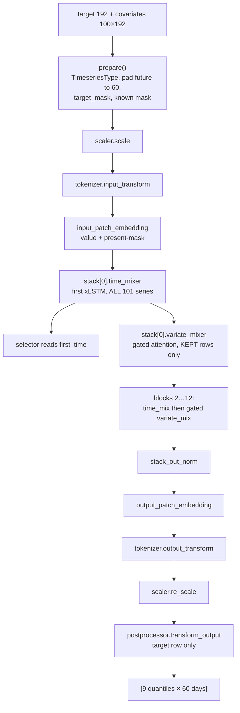

| Stage | Function | Series that run |
|-------|----------|-----------------|
| `prepare` | Pack tensors, pad the 60-day future with NaN, build masks | All 101 |
| `embed` | Scale, patch, embed, **first time mixer** | All 101 |
| selector | Score covariates from `first_time` | Reads all 101; does not run the stack |
| `run_stack` | Remaining variate mix of block 0, then blocks 1–11, then head | **Target + kept covariates only**, batched over horizons |
| `decode_target` | TiRex-2 output calibration on the target row | Target |

The first time mixer is always paid in full. That is the price of giving the selector a TiRex-2 representation of every series. The saving is in the **12 variate-attention blocks plus the later time mixers**, which dominate FLOPs when 100 extra series are present.

---

## 6. The DHS selector

### 6.1 Inputs taken from the first xLSTM

`DHSSelector.features` reads `embedded.first_time`:

- **Covariate vector** \(x_i \in \mathbb{R}^{512}\): mean of covariate \(i\) over **context patches**, then LayerNorm.
- **Target state** \(h_t \in \mathbb{R}^{512}\): the target’s **last context patch**, then LayerNorm.

The future-pad patches are excluded from that mean (`context_patches`).

### 6.2 Gate formula

For covariate \(i\) and horizon index \(h \in \{0,1,2\}\) (standing for 7, 30, 60 days):

\[
g_{ih} = \sigma\Big( v^\top \tanh(W_x x_i + W_h h_t + W_e e_h + b) + c \Big)
\]

Implemented as:

1. `base = W_x(x_i) + W_h(h_t)`  shape `[N, 64]`
2. `hidden = tanh(base + W_e(e_h))`  broadcast over horizons → `[H, N, 64]`
3. `logit = v(hidden)`  `[H, N]`
4. `g = sigmoid(logit)`

| Piece | Size | Why it exists |
|-------|------|----------------|
| Horizon embedding \(e_h\) | 3 × 16 | Different keep-sets for 7 vs 30 vs 60 days |
| \(W_x\) | 512 → 64, no bias | Covariate-specific score |
| \(W_h\) | 512 → 64, no bias | Window / load-regime context |
| \(W_e\) | 16 → 64, with bias | Horizon-specific offset |
| Hidden tanh 64 | — | Lets context and horizon **rerank** covariates, not only raise or lower all gates together |
| \(v\), scalar bias \(c\) | 64 → 1 | Final logit; \(c\) is set so \(g \approx 0.9\) at init |

A purely linear score \(\sigma(W_x x_i + W_h h_t + W_e e_h + b)\) would add the same \(h_t\) and \(e_h\) terms to every covariate. Those terms could only move **all** gates together. The tanh layer is the “dynamic, horizon-aware” part: ranking can depend on the current window and the horizon.

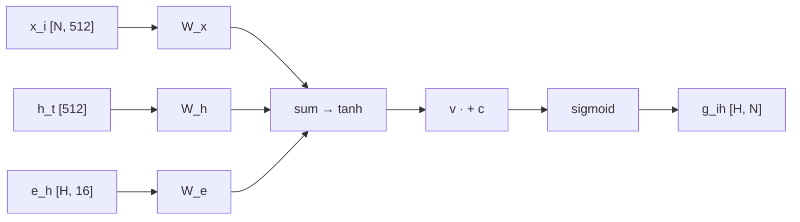

Output logits have shape **`[3, 100]`**: three horizons, 100 covariates. The target is never gated; it is always row 0 of every attention group.

---

## 7. Soft training vs hard gather inference

This is the architectural split that defines “aggressive gather”.

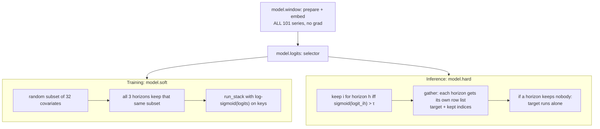

### 7.1 Soft path (`DHSModel.soft`)

Used only while training the selector.

- Every selected covariate stays in the graph.
- Gate enters attention as \(\log g_{ih}\) on that series’ **key** (implemented as `logsigmoid(logit)` on kept rows).
- \(g = 1\) reproduces TiRex-2; \(g \to 0\) is equivalent to deleting the series (`tests/test_backbone.py` checks both).
- A **random 32-covariate subset** is used each step so backpropagation through 12 blocks fits on an 8-thread CPU. The selector weights are shared, so it still learns a score for any client.

### 7.2 Hard path (`DHSModel.hard`) — the gather

Used for validation tuning and for the timed test.

1. \(g_{ih} = \sigma(\text{logit}_{ih})\)
2. `kept[h] = { i | g_ih > τ }`
3. For each horizon, build the row list `[0] + (kept + 1)` (row 0 is the target; covariate \(i\) lives at row \(i+1\)).
4. Key bias on kept covariates is still \(\log g_{ih}\) (`logsigmoid` of the kept logits). Dropped series get **no rows**.
5. `run_stack` `index_select`s only those rows from `first_time`.

If every gate is below \(\tau\), `kept[h]` is empty and the stack processes **one series per horizon**: univariate TiRex-2.

### 7.3 One batched pass, three attention groups

The three horizons are concatenated in one `run_stack` call:

```
rows:    [target, kept_7...] [target, kept_30...] [target, kept_60...]
groups:  [1, 1, ...]         [2, 2, ...]          [3, 3, ...]
```

Variate attention only allows keys/queries with the **same group id**. Horizons never attend to each other. Covariates never attend to the target as queries in the TiRex-2 mask sense (`target_mask`); they may act as keys for the target.

That is why, when no covariate is kept, **series through the stack = 3** (the target copied once per horizon), not 1.

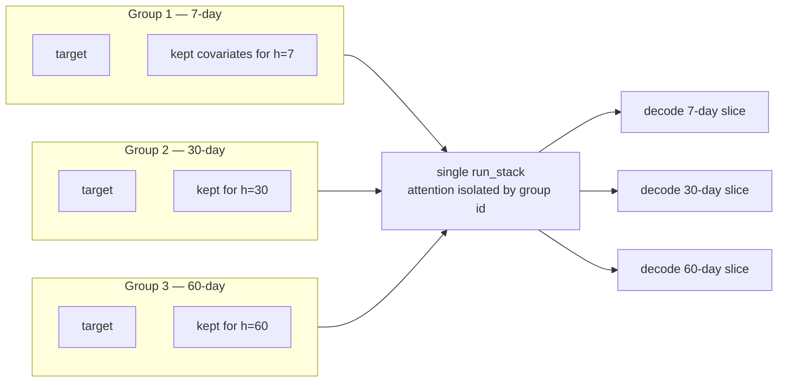

---

## 8. Where the gate acts (variate attention)

`variate_mix` is TiRex-2’s `AttentionBlock` with an extra **per-key bias**.

```
allowed(i, j) = same group AND not (query is covariate AND key is target)
attn_mask     = 0 if allowed else −∞
attn_mask    += key_bias[j]     # log g for covariate keys; 0 for the target
```

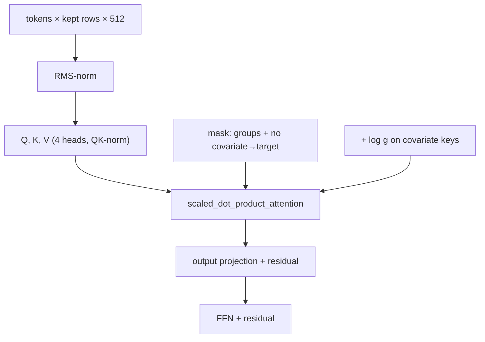

This is applied in **every** block’s variate mixer, including block 0 after the first time mix. Time mixers stay per-series and are not gated.

---

## 9. Training the selector

TiRex-2 weights have **no gradient**. Adam updates only `DHSSelector`.

### 9.1 Loss

\[
L = L_{\text{forecast}} + \lambda_1(t)\, L_{\text{sparse}} + \lambda_2\, L_{\text{stable}}
\]

| Term | Definition | Intent |
|------|------------|--------|
| \(L_{\text{forecast}}\) | Mean pinball over 9 quantiles and days \(1..h\) for each horizon, divided by that window’s mean \(\lvert\text{target}\rvert\) | Match TiRex-2’s quantile head; equalise high- and low-load windows |
| \(L_{\text{sparse}}\) | Mean of all \(g_{ih}\) | Push unused gates toward 0 (L1 on gates, which already lie in \([0,1]\)) |
| \(L_{\text{stable}}\) | \(w_t \cdot \mathrm{mean}\lvert g_t - g_{t-1}\rvert\) | Do not flicker the keep-set unless the context moved |
| \(w_t\) | \(\exp(-\lVert \hat h_t - \hat h_{t-1}\rVert)\) on L2-normalised states | \(\approx 1\) if the regime is unchanged; smaller if load state jumped |
| \(\lambda_2\) | 0.01 | Fixed |
| \(\lambda_1(t)\) | \(\lambda_1 \cdot \min(1, (t+1)/T_{\text{warmup}})\) | Warmup = 30% of steps, so gates do not collapse before the forecast loss has a say |

Default grid: \(\lambda_1 \in \{0, 0.001, 0.01, 0.1\}\). Even \(\lambda_1 = 0\) can drive gates to 0 if the forecast loss prefers that.

### 9.2 One training step

```mermaid
sequenceDiagram
    participant P as Panel
    participant W as window() frozen
    participant S as Selector
    participant Soft as soft stack (32 covs)
    participant Opt as Adam

    P->>W: context at origin and origin-1
    W->>S: first_time → logits_t, logits_{t-1}
    S->>Soft: subset of 32 covariates, all 3 horizons
    Soft->>Soft: pinball vs actuals 7/30/60
    S->>S: sparse = mean(g_t)
    S->>S: stable = w_t * mean|g_t - g_{t-1}|
    Soft->>Opt: backward through stack into selector only
    Opt->>S: update ~67k parameters
```

Settings: 2 epochs, 74 shuffled train windows, learning rate \(10^{-2}\), seed 0, subset 32, CPU 8 threads (or CUDA if requested).

---

## 10. Validation tuning (choose λ₁ and τ)

Inference hardness is controlled by **τ**. Training never uses τ.

Grid:

- \(\lambda_1 \in \{0, 0.001, 0.01, 0.1\}\)
- \(\tau \in \{0.3, 0.5, 0.7\}\)
- 12 configurations, each scored on 50 validation windows with **hard** gather

Selection rule (`pipeline.tune`):

1. Find the lowest mean validation CRPS.
2. Keep every config within **2%** of that CRPS.
3. Among those, pick the **fewest active covariates**, then the lower CRPS.

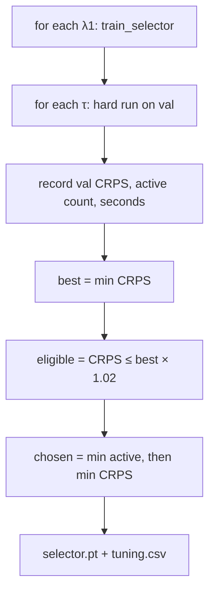

The test windows are not used in this loop. They run once at the end with the chosen \((\lambda_1, \tau)\).

---

## 11. Timed test path (what “seconds per window” includes)

`run_windows` times everything a deployment would do for one origin:

1. `panel.context` — 192 days of target and 100 covariates  
2. `prepare` + `embed` — all 101 series through the first xLSTM  
3. selector logits  
4. hard gather + `run_stack` + `decode_target`  
5. GPU/CPU sync  

FLOPs are counted with PyTorch’s operator counter on the first 3 test windows of that same `hard` call. Peak memory is process RSS during the test loop minus RSS before it.

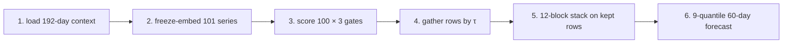

---

## 12. Metrics and reports

| Output | Meaning |
|--------|---------|
| `metrics_by_horizon.csv` | MAE, RMSE, CRPS, bias, MAPE, 80% coverage/width, active covariates |
| `window_metrics.csv` | Per-window MAE and CRPS |
| `window_timing.csv` | Wall-clock seconds per origin |
| `efficiency.json` | Mean/median time, GFLOPs, peak added RAM, series through stack, training minutes |
| `interval_calibration.csv` | Observed coverage of 20/40/60/80% central bands (60-day) |
| `forecasts.npz` | All quantile forecasts and actuals |
| `gates.npz` | \(g_{ih}\) and the 0/1 keep mask per window |
| `selector.pt` | Weights + chosen λ₁/τ |
| `tuning.csv` / `training_history.csv` | Validation grid and epoch losses |
| `figures/` | MAE by window, metrics by horizon, calibration, gate heatmap, active counts |

CRPS is **twice** the mean pinball loss over the nine quantile levels. The 7- and 30-day scores slice the same 60-day tensor.

---

## 13. End-to-end pipeline

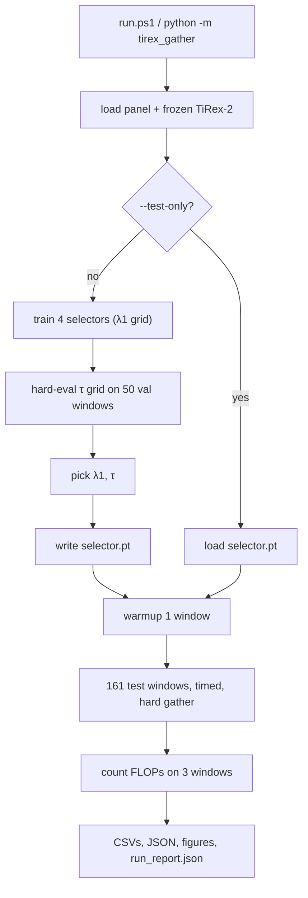

`--quick` shrinks epochs, strides, and the λ/τ grids so the wiring can be checked without a full 1.5-hour run.

---

## 14. Contrast with the other two projects

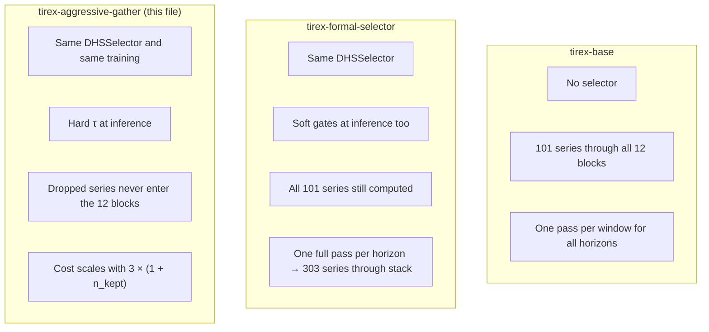

| | Base | Formal (soft) | **Gather (hard)** |
|--|------|----------------|-------------------|
| Who is trained | nobody | selector | **selector** |
| Gate at test time | none (all in) | \(g \in (0,1]\), all series stay | **keep iff \(g > \tau\)** |
| Series through 12 blocks | 101 | 303 | **3 × (1 + covariates kept)** |
| Saves compute when gates are ~0 | no | no | **yes** |

Formal and gather share the selector math and the training loop. Gather is the architecture that turns a near-zero gate into skipped FLOPs.

---

## 15. What this architecture does at runtime on the published run

The diagrams above are the **design**. On the 3 October 2026 CPU run the selector’s scores went to \(\approx 0\) for every covariate, every horizon, and every test window. Hard gather therefore kept **0 of 100** series. The stack ran the target three times (once per horizon): **3 series through the 12 blocks**, **0.23 s** and **19.3 GFLOPs** per window, versus **1.85 s** and **255 GFLOPs** for base TiRex-2 with all covariates. Accuracy stayed statistically the same.

That is not a missing branch in the architecture. It is the hard path with an empty keep-set: univariate TiRex-2, which this design explicitly allows.

---

## 16. Component checklist (implementation)

| Responsibility | Code |
|----------------|------|
| Chronological splits | `data.Panel.train_origins` / `val_origins` / `test_origins` |
| Scale, patch, first xLSTM | `backbone.prepare`, `backbone.embed` |
| Gated attention | `backbone.variate_mix` (`key_bias`) |
| Sparse stack | `backbone.run_stack` (`rows`, `group`) |
| Target postprocess | `backbone.decode_target` |
| Feature extract + gates | `selector.DHSSelector` |
| Stability weight \(w_t\) | `selector.context_weight` |
| Soft / hard dispatch | `forecast.DHSModel.soft` / `.hard` |
| Pinball + sparse + stable | `training.train_selector` |
| λ / τ selection | `pipeline.tune` |
| Test timing + reports | `pipeline.run` |
| Equivalence \(g\to 0\) ≡ drop | `tests/test_backbone.py` |
